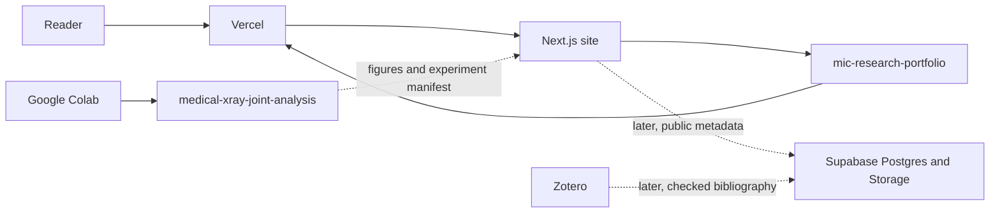
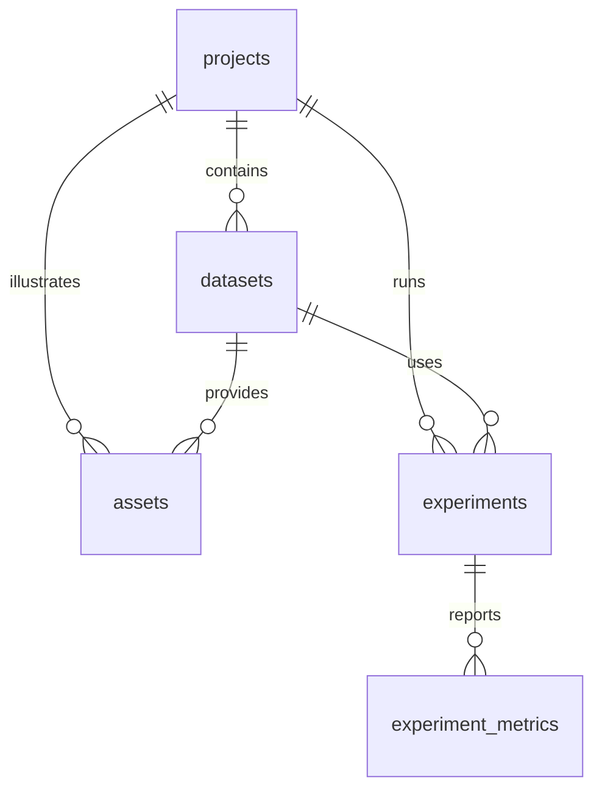

# Phase 0 — architecture for the MIC research portfolio

This note records the decisions for the first build. It is a plan, not a claim that experiments, datasets, or deployments exist.

Official University of Girona dates and the current MIC curriculum still need to be checked on the university site before any deadline is treated as real. The intended entry year in the copy is 2027/2028, subject to admission.

## Critical review

The proposed stack is sound for a public academic portfolio: Next.js on Vercel, PostgreSQL on Supabase, scientific code in separate Python repositories, Zotero as the bibliography source. Four choices in the original brief should be narrowed.

1. **Content does not need a database on day one.** The pages, project status, and topic list are source code. A database becomes useful when images, experiment rows, and papers need to be queried. Shipping Supabase before that adds credentials and policy risk without a reader-visible feature.

2. **Experiment files should be the source of truth.** A Colab notebook that writes metrics into Supabase needs a secret and is harder to review. A notebook that saves figures and a small JSON manifest, committed to the research repository, can be read by the website at build time. Supabase can index those manifests later. Git remains the record of what was run.

3. **Zotero sync is the fragile integration.** It can leak private notes, duplicate records, or attach a PDF that should not be redistributed. The first bibliography entries should be typed into the site, or exported once by hand, after each DOI and free-access link is checked. Automation comes after that path has been done manually at least once.

4. **Fourteen tables now would be unused surface area.** Papers, annotations, and academic outputs have no rows. The first migration keeps the five tables required by the hand-radiograph slice.

What stays from the original brief: separate research repositories, no training on Vercel, no service-role key in the browser, no invented metrics, and licenses checked before any image is stored.

## Minimal path

1. This website, with honest planned-status pages. **In progress locally.**
2. GitHub repository `mic-research-portfolio` and a Vercel deploy. **Waiting on account setup.**
3. One permitted hand radiograph, a Colab notebook that runs histogram and filtering steps, committed figures, and those figures shown on the X-ray project page.
4. Supabase applied only when that image and its experiment manifest need a database record. The SQL is already drafted.
5. Zotero, MRI, and CT work after the X-ray slice is real.

## System



Solid arrows are the first working path. Dotted arrows wait until there is a licensed image or a checked paper.

## Data model



| Table | Holds | Public read |
| --- | --- | --- |
| `projects` | The three portfolio projects | Only rows with `visibility = public` |
| `datasets` | Source, version, license, de-identification | Public only if redistribution is allowed and the data are de-identified |
| `assets` | Storage path and image geometry, not the file bytes | Public only if `deidentified` is true |
| `experiments` | Method, parameters, commit, seed, environment, split, limitations | Only published runs |
| `experiment_metrics` | Metric name and value; value may be empty while a run is planned | Follows the parent experiment |

Image bytes go in Storage buckets `public-figures` and `research-private`. There is no insert policy for browser users. The service role is the only writer, and only from a machine or Action that is allowed to see the key.

Postponed tables: `papers`, `topics`, `paper_topics`, `paper_projects`, `reading_notes`, `annotations`, `notebooks`, `academic_outputs`, `project_milestones`. Topics and academic plans currently live in `src/lib`.

## Repositories

```text
~/dev/mic_portfolio/                     website, this Cursor workspace
  src/app/                               routes
  src/components/
  src/lib/                               typed content until the database is connected
  supabase/migrations/                   SQL, not yet applied
  docs/
  .github/workflows/ci.yml

~/dev/medical-xray-joint-analysis/       create when the first notebook starts
  README.md
  pyproject.toml
  src/
  notebooks/
  tests/
  configs/
  reports/
  figures/
  docs/
  data/README.md
  .github/workflows/

~/dev/ketamine-brain-mri-analysis/       same template, later
~/dev/lung-ct-airway-analysis/           same template, later
```

The website folder can stay `mic_portfolio` locally. The GitHub name can still be `mic-research-portfolio`.

## Website map

- `/`
- `/research`
- `/research/rheumatoid-arthritis`
- `/research/ketamine-mri`
- `/research/lung-ct`
- `/library`
- `/library/[paper]` when the first verified paper exists
- `/foundations`
- `/foundations/[topic]`
- `/academic`
- `/about`

## Zotero, when the library phase starts

Collections follow the three groups already on the library page: MAIA foundations, MIC specializations, and the three projects.

Tags:

- `topic/<slug>` matching `src/lib/library.ts`
- `project/rheumatoid-arthritis`, `project/ketamine-mri`, `project/lung-ct`
- `difficulty/introductory`, `difficulty/intermediate`, `difficulty/advanced`
- `reading/unread`, `reading/reading`, `reading/read`
- `oa/verified` only after a free-access URL is opened and saved
- `publish-note` on a note that is allowed to appear on the website

The later GitHub Action will read the Zotero API, validate title, authors, year, and an identifier, resolve a DOI when present, call a free-access lookup such as Unpaywall, and upsert by Zotero item key. It will not download PDFs, not publish notes without `publish-note`, and not delete a site record because a sync failed. Failures stay in the Action log.

## First X-ray workflow

This workflow is not running. The image has not been chosen.

1. Find one hand radiograph whose license allows storage and public display. Record the source URL, license, and a statement that the file contains no direct identifiers.
2. Put the file in the X-ray repository if it is small and the license allows Git, or in the private Supabase bucket if redistribution is narrower than the code license.
3. Open a beginner notebook in Colab from that repository. The notebook loads the image, plots the histogram, applies a Gaussian filter, an edge detector, and a threshold, and writes figures plus `experiments/xray-stage1.json`.
4. The JSON records dataset version, commit, parameters, environment, and status. It does not contain a diagnostic claim.
5. The website project page renders those figures and the JSON. Status changes from planned to completed for Stage 1 only.
6. A database row is optional at this point. Add it when a second experiment makes search worthwhile.

Dice and IoU belong to Stage 2, after an annotated dataset exists. They will not be filled in for the single-image preprocessing notebook.

## Backlog

| Order | Work | Depends on | Done when |
| --- | --- | --- | --- |
| 0 | Local site skeleton | Nothing | `npm run dev` shows every planned page, with no fabricated results. |
| 1 | Profile env, GitHub login, empty Supabase project | Your accounts | `.env.local` is filled and `gh auth status` succeeds. SQL is still unapplied. |
| 2 | Review and apply the migration | Step 1 and an explicit yes | The five tables exist, public read works, browser roles cannot write. |
| 3 | Create and push `mic-research-portfolio` | Step 1 and an explicit yes | The GitHub repository contains this code and CI is green. |
| 4 | Import the project in Vercel | Step 3 | The production URL loads the same pages. |
| 5 | Choose one licensed hand radiograph | A written license check | Source, license, and de-identification note are in the repo. |
| 6 | Stage 1 notebook and figures | Step 5 | The notebook runs in Colab and the project page shows its figures. |
| 7 | Verified bibliography seed | Papers you have actually checked | Each public record has authors, year, venue, and a source link. |
| 8 | Zotero sync | Step 7 done by hand once | A dry run logs changes and publishes no private notes. |
| 9 | MRI and CT repositories | The X-ray slice is the template | Each repo has the same layout and a beginner notebook plan. |

## Acceptance for the current step

- The site builds.
- Every project says planned.
- No metric values, dataset names, paper citations, or repository URLs are invented.
- The service-role key is absent from client code.
- The SQL file is present and unapplied.

## Postponed on purpose

Vercel deploy, Zotero, paper detail pages, learned segmentation, registration code, CT volumes, authentication, and admin editing. None of these are required to finish the account setup or the first X-ray notebook.
